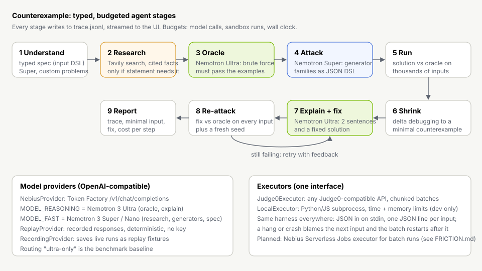

# Counterexample

**License: MIT** · Built for the Nebius x NVIDIA Global AI Hackathon (Coding and Agentic Engineering track)

**A coding agent that doesn't stop at "tests pass".** Give it a problem and a solution (your interview answer, or code an AI wrote). It does what a strong interviewer does: builds a slow but obviously-correct oracle, designs adversarial inputs, runs thousands of them in a sandbox, shrinks any mismatch to a **minimal counterexample**, explains the bug in two sentences, proposes a fix, and **re-attacks the fix** before calling it fixed.

```
solve([0], 0)          expected 0, got -1            binary search, loop exits at lo == hi
solve(2147483647)      expected 46340, got 0         integer sqrt, (lo + hi + 1) >> 1 overflows
solve([2, 3], 4)       expected 2, got -1            coin change, greedy
solve("baab")          expected 2, got 3             sliding window moves backwards
```

## How it uses Nebius Token Factory and NVIDIA Nemotron

| Step | Model | Why |
| --- | --- | --- |
| Oracle (brute-force reference) | **Nemotron 3 Ultra** | A wrong oracle means false alarms, so correctness beats latency. It must pass the statement's examples before it is trusted. |
| Adversarial generators | **Nemotron 3 Super** (or Nano) | Generator families are cheap to try and are checked by a typed DSL and the problem's constraints, so speed wins. |
| Research summary (Tavily) | Super | Extracting cited facts from search results is extraction, not deep reasoning. |
| Explain + fix | **Nemotron 3 Ultra** | Root-causing a bug from one minimal input needs deep reasoning. |

All calls go through Token Factory's OpenAI-compatible endpoint (`NEBIUS_BASE_URL`, `NEBIUS_API_KEY`, `MODEL_REASONING`, `MODEL_FAST`). The report's **"Why Ultra here, Super there"** panel shows model, tokens, cost and latency for every step, and the benchmark compares this routing with an Ultra-only baseline.

**Tavily** runs when the statement leans on external facts (for example "constraints follow LeetCode 704") or when the user ticks **Research the web**. Facts come back with URLs, are cited in the trace, and the trace shows which generator families they shaped.

**Share a report by link.** "Share link" puts the report (without its trace) into the URL fragment, deflate-compressed and base64url-encoded with the browser's own Compression Streams API. Browsers never send the fragment to the server, so opening the link decodes the report in the reader's browser, after size caps and schema validation. The whole link (origin, path and fragment) is capped at 8,000 characters, the minimum URI length RFC 9110 asks software to support; a larger report is downloaded as JSON instead, with the same content a link would carry.

## Design choices that matter

- **Generators, not test cases.** The fast model writes input *families* in a small JSON DSL (`src/lib/core/spec.ts`): ints with edge bias, arrays (sorted, distinct, duplicate pools), strings, tuples, DAGs as edge lists. Model output is interpreted, never executed, and every generated input is checked against the problem's declared constraints, so an over-eager generator cannot cause a false alarm.
- **Mutation on top of generation.** After the model's families, type-aware mutants of the examples and of every input already tried (±1, negation, duplicated or dropped elements, swaps, repeated slices) run as their own family, after EvalPlus. They are filtered by the same validator.
- **Delta debugging over structured inputs** (`src/lib/core/shrink.ts`): chunk removal, element simplification, binary search on integers, isolated-node removal with relabelling for graphs. A well-founded size measure guarantees termination; the problem's validator keeps every step legal.
- **One harness, any sandbox.** Code is wrapped in the same JSON-lines harness for every executor (`src/lib/exec/program.ts`). If one input hangs or crashes, the next unreported input is blamed and the batch restarts after it, so one bad input never loses the rest.
- **Budgets and an honest verdict.** Model calls, sandbox runs and wall clock are budgeted per attack. If the oracle never matches the examples, the verdict is `oracle_unreliable` and **no bug is claimed**. If nothing breaks, the report says "evidence, not proof".
- **Robust at the edges.** Every external input is schema-validated with zod: the API body, every model answer (generator families, research facts, problem specs), and every Token Factory, Tavily and Judge0 response. Network calls have per-attempt timeouts, bounded retries with full-jitter backoff (honouring `Retry-After`) and an idempotency key. Failures are typed errors (`src/lib/errors.ts`). Nothing falls back silently: a failed search, a rejected family, an unpriced model or an unverified fix each show up in the trace and the report.
- **Deterministic replay.** `ReplayProvider` serves recorded responses, so the whole loop runs in tests and for judges without a key. `pnpm bench --live --record` turns a live run into new fixtures.



## Benchmark

`bench/solutions/` holds 10 problems with 30 known-buggy solutions (each file's first line documents the bug) and 10 correct ones. `pnpm bench --readme` reruns everything and rewrites the table below; **every number here comes from that script** (`bench/run.ts`, full per-solution results in `bench/results/`).

### Fixture mode (replayed model responses, real execution)

<!-- bench:fixture:start -->
Mode: **fixture** (replayed model responses; token counts estimated from text length, model latency simulated; execution is real). Executor: Local subprocess (dev only, not sandboxed).

| Metric | Routed (Ultra + Super) | Ultra only | Ablation: no model generators (1000 uniform random inputs) |
| --- | --- | --- | --- |
| Bugs found (of 30 buggy) | 30 (100%) | 30 (100%) | 27 (90%) |
| False alarms (of 10 correct) | 0 | 0 | 0 |
| Fixes verified by re-attack | 30 of 30 | 30 of 30 | 27 of 27 |
| Median time to first counterexample | 4.8 s | 10.2 s | 2.2 s |
| Model cost per solution | $0.0014 | $0.0027 | $0.0008 |
| Model cost, all 40 solutions | $0.0561 | $0.1077 | $0.0336 |
| Runs ending in error / budget / bad oracle | 0 | 0 | 0 |
<!-- bench:fixture:end -->

How to read this honestly:

- In fixture mode the generator families and oracles are **recorded responses we wrote**, knowing the bug classes. These numbers measure the pipeline (oracle check, generation, sandbox runs, shrinking, re-attack), not Nemotron's judgement. Token counts are estimated from text length and model latency is simulated, so time-to-first-counterexample is dominated by simulated latency (Ultra is slower per token, which is why Ultra-only is slower).
- The ablation row is the useful one: **uniform random inputs alone already find most of these bugs**. The ones they miss are exactly the ones that need targeted inputs: the int32 midpoint overflow (only `x = 2^31 - 1`), the `x = 0 / 1` bound in integer sqrt, and crossed brackets like `([)]`.

### Live mode (Token Factory + Tavily)

<!-- bench:live:start -->
**Pending a key (see `BLOCKED.md`).** No `NEBIUS_API_KEY` / `TAVILY_API_KEY` was available in the build session, and the session's network policy blocked `api.tokenfactory.nebius.com` (see `docs/FRICTION.md`). Run `pnpm bench --live --readme` to fill this section.
<!-- bench:live:end -->

## Run it

```bash
pnpm install
pnpm test                 # unit (incl. fast-check properties), integration, replay end to end
pnpm dev                  # http://localhost:3000, replay mode without keys
pnpm bench                # fixture-mode benchmark (Python 3 and Node needed for the local executor)
```

Live mode: copy `.env.example` to `.env.local` and set `NEBIUS_API_KEY` (plus `TAVILY_API_KEY` for research). Confirm the model ids against Token Factory's model list first.

Sandbox: set `JUDGE0_URL` (and `JUDGE0_TOKEN`, or `JUDGE0_RAPIDAPI_HOST` for RapidAPI) to run code on any Judge0-compatible API. The repo ships its own: **the Counterexample sandbox** (`sandbox/`, one small container) runs as a **Nebius Serverless AI endpoint**, so the models run on Token Factory and the attacked code runs on Nebius AI Cloud. See [docs/NEBIUS-SANDBOX.md](docs/NEBIUS-SANDBOX.md). Run it locally with `pnpm sandbox` (or Docker) and set `JUDGE0_URL=http://localhost:2358`. Without a sandbox, the **local executor** runs Python/JS as subprocesses with time and memory limits. **It is for development only: it is not a security sandbox**, and production refuses it unless `ALLOW_LOCAL_EXECUTOR=1`.

Credentials check: once keys are set, `pnpm preflight` makes one real call to each service. It lists the Token Factory models and checks that both Nemotron ids are offered, sends a one-line prompt to each model, runs one Tavily search, and runs the harness once per language on the sandbox. A missing credential is reported as `skip`, never as a pass.

Deployment: a Vercel preview works for the UI; set the env vars above.

## Load and limits

- **Per attack:** at most 8 model calls on the public endpoint (12 in the library), 60,000 sandbox runs and 50 s of wall clock. That works out to about 300 inputs per family, 2,000 shrink evaluations, 3 oracle attempts and 2 fix attempts. Measured on the 40 benchmark solutions (routed, replay): 2 to 4 model calls and 1,444 to 3,093 sandbox runs per attack (median 2,276). Generated values are capped by the DSL (lengths up to 10,000; at most 200,000 values per input). The local executor caps process output at 32 MB, and a process pool sized to the CPU count bounds concurrent processes.
- **Per server instance:** `MAX_CONCURRENT_ATTACKS` (default 4), `RATE_LIMIT_PER_HOUR` and `ATTACKS_PER_IP_PER_DAY` per IP, and `DAILY_SPEND_CAP_USD` across all live attacks. The IP table is capped at 10,000 entries. If the client disconnects, the attack stops at its next model call or sandbox run.
- **Expected load and where it breaks first:** a hackathon demo, with tens of concurrent users at most. The first limit hit is the sandbox. Each attack would send 17 to 47 Judge0 submissions (median 27, at 200 inputs per submission, measured on the benchmark), so a shared Judge0 instance saturates first; the concurrency cap turns that into a fast 503 instead of a pile-up. Next come the guards: they live in memory, so with N serverless instances the effective limits are N times higher. A shared store (Redis or Vercel KV) is the fix, and it is the one change needed before a real launch. Token Factory cost is capped per day; Token Factory latency (not measured yet; see `BLOCKED.md`) sets the wall-clock floor.

## Layout

```
src/lib/core      input DSL, seeded RNG, comparison, shrinker
src/lib/exec      Executor interface, harness, Judge0Executor, LocalExecutor
src/lib/models    Token Factory client, replay + recording providers, routing, pricing
src/lib/agent     run.ts (orchestrator), stages, families, judge, model calls, prompts, parsers, budgets, trace, guards
src/lib/net       postJson: timeouts, retries with backoff, idempotency key
src/lib/research  Tavily client and research trigger
src/fixtures      replay fixtures for the 10 problems
tests/unit        pure functions, fast-check property tests (seeded; FC_SEED=n to explore)
tests/integration executors, providers (mocked HTTP), API route, failure paths, fixtures vs sandbox
tests/e2e         the whole loop in replay mode
src/app           Next.js UI and /api/attack (NDJSON stream)
bench/            solutions, benchmark script, results
docs/             FEEDBACK, FRICTION, VIDEO shot list, architecture.svg
```

Built by the AlgoCracked team. Interview prep is the first use; attacking AI-written code before you merge it is the everyday one.
